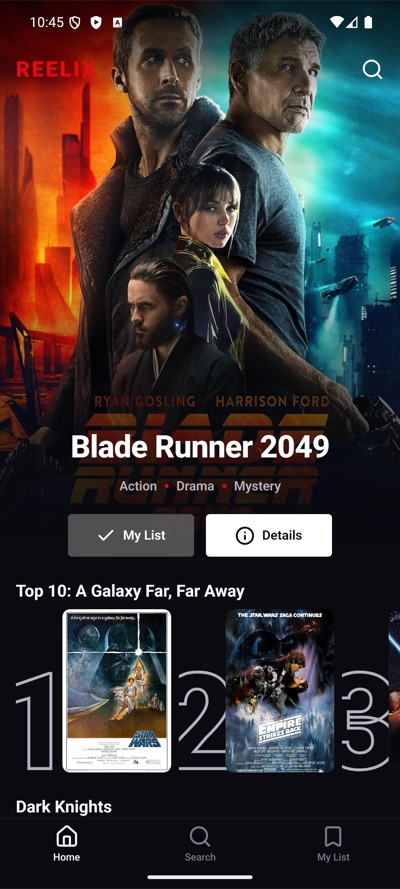
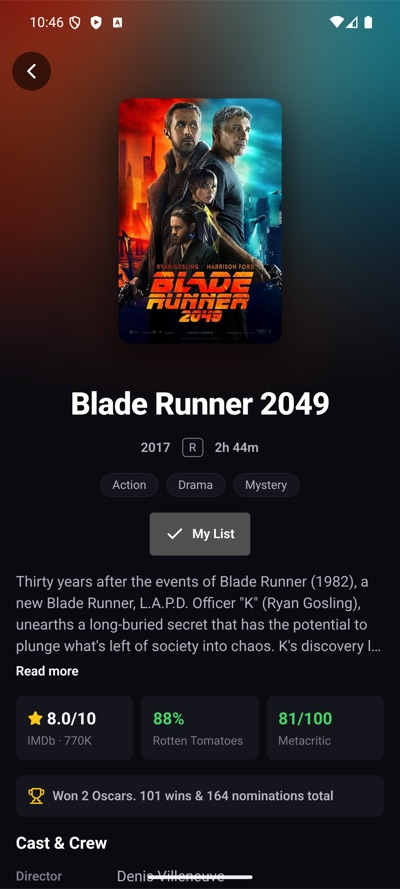
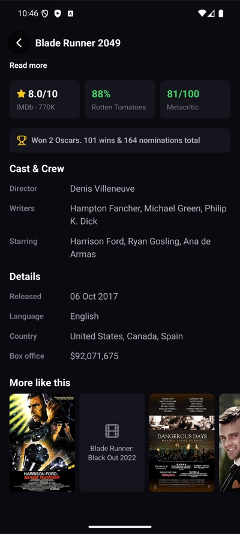
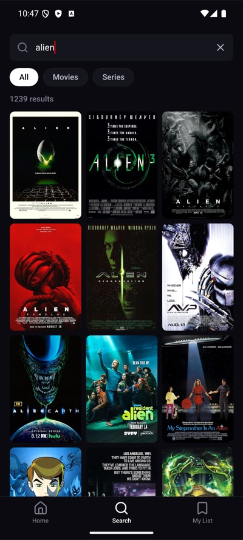
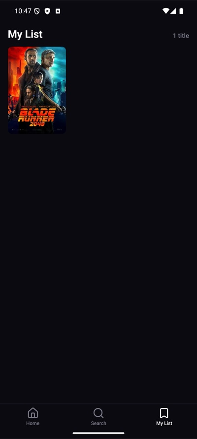
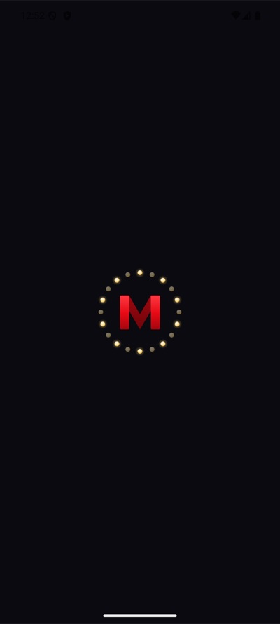
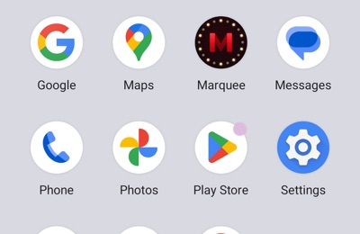
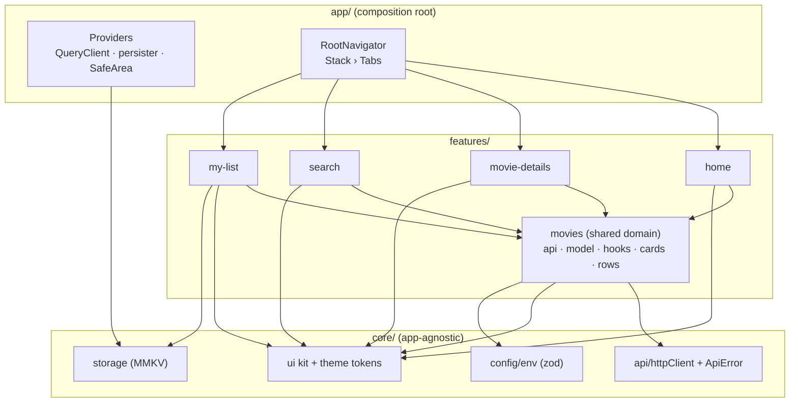

# Marquee

A Netflix-style movie browser built with **React Native 0.88 (CLI, New Architecture)**, **TypeScript** and the **OMDb API**.

The home screen is a vertical feed of horizontal shelves. Tapping any title opens a details screen. The app also ships a Search tab, a persisted My List, offline awareness and a cache that survives restarts. It is meant as a foundation for a full product: features are isolated, the data layer is typed end to end, and the module boundaries are enforced by lint rules.

| Home                               | Details                                  | Details (scrolled)                                         | Search                                 | My List                                  |
| ---------------------------------- | ---------------------------------------- | ---------------------------------------------------------- | -------------------------------------- | ---------------------------------------- |
|  |  |  |  |  |

## Features

- **Home feed**
  - A featured hero that rotates daily.
  - Eleven themed shelves in three visual variants: poster, wide (landscape with a title overlay) and "Top 10" ranked cards with outlined numerals.
  - Horizontal infinite pagination inside each shelf.
  - Skeletons while loading, plus an inline error and retry per shelf, so one failing row never breaks the page.
  - Pull to refresh, and a header that fades in as you scroll.
- **Movie details**
  - The screen renders **instantly** from data already in the cache: title, poster and year come from the search result that was tapped. The full record is also prefetched on press-in.
  - A blurred backdrop with parallax, and a top bar that fades in on scroll.
  - Metadata (year, rating, runtime), genre chips, and a plot with "Read more".
  - IMDb, Rotten Tomatoes and Metacritic scores, awards, cast and crew, release info.
  - A "More like this" shelf. Details screens can be pushed onto each other indefinitely.
- **Search**
  - Debounced as you type, with All / Movies / Series filters.
  - Infinite results grid and a result count.
  - Friendly states for idle, no-results and too-broad queries.
- **My List**
  - Save or unsave titles from the hero or the details screen.
  - Persisted with MMKV, so it survives restarts.
- **Offline**
  - An animated offline banner.
  - Queries pause while offline and refetch automatically on reconnect.
  - The query cache is persisted, so a cold start without network still shows the last feed.
- **Resilience**
  - Error boundaries at three levels: each shelf (including "More like this"), the hero, and the whole app.
  - A rendering bug in one shelf replaces only that shelf with a "couldn't be displayed — Retry" card. Anything uncaught shows a branded "Something went wrong — Try again" screen, never a blank one. That screen also hides the launch screen, so a crash during startup can't leave the app stuck on the logo.
  - Fallbacks read the error and `reset` through a `useErrorBoundary()` hook, so every fallback is a real component and can safely use hooks.
- **Branding**
  - The name comes from the lit sign above a cinema entrance. The mark is a folded red "M" inside a ring of alternating lit and dim bulbs, like chase lights.
  - The icon covers iOS (a single 1024px universal icon) and Android (adaptive foreground and background layers, a monochrome layer for Android 13+ themed icons, plus legacy square and round PNGs).
  - The native launch screen uses [`react-native-bootsplash`](https://github.com/zoontek/react-native-bootsplash): the Android 12+ splash API and an iOS storyboard. It stays up until navigation has mounted and the persisted cache has been restored, then fades out. The first frame users see is therefore the cached feed, not skeletons.

| Launch screen                          | Launcher                                   |
| -------------------------------------- | ------------------------------------------ |
|  |  |

All brand assets are generated from one vector definition in `scripts/generate-brand-assets.mjs`. Run `npm run brand` to regenerate the icons and the splash after changing the artwork.

## Getting started

### Prerequisites

| Tool                 | Version                                                           |
| -------------------- | ----------------------------------------------------------------- |
| Node                 | ≥ 22.13 (required by React Native 0.88; `nvm use` reads `.nvmrc`) |
| JDK                  | 17 (Android)                                                      |
| Android Studio / SDK | API 35 emulator or a device                                       |
| Xcode                | 16+ with the license accepted (`sudo xcodebuild -license accept`) |
| Ruby + Bundler       | for CocoaPods (`bundle install`)                                  |

Follow the official [environment setup guide](https://reactnative.dev/docs/set-up-your-environment) if this is a fresh machine.

### Install and run

```sh
npm install

# Configure the OMDb key (get a free one at https://www.omdbapi.com/apikey.aspx).
# Skip this if your copy already contains a .env, as the review zip does.
cp .env.example .env          # then set OMDB_API_KEY

# iOS (first time, and whenever native deps change)
bundle install
cd ios && bundle exec pod install && cd ..

npm start                     # Metro
npm run android               # or: npm run ios
```

If `bundle install` fails, you're probably on macOS's system Ruby (2.6), which can't install gems without `sudo`. Either use a Ruby version manager such as `rbenv`, or run `cd ios && pod install` with a globally installed CocoaPods (1.13 or later, except 1.15.0 and 1.15.1).

iOS was verified on an iPhone 17 Pro simulator running iOS 26.5. On the older iOS 17.5 simulator runtime, the app crashes at launch with a missing `libc++` symbol (`std::exception_ptr::__from_native_exception_pointer`). That comes from React Native 0.88's prebuilt iOS core being compiled with the Xcode 26 toolchain; it is not caused by this app's code. Use an iOS 18+ simulator, or build React Native from source with `RCT_USE_PREBUILT_RNCORE=0 pod install`.

`.env` is read at build time by `react-native-config`. After changing it, rebuild the native app; a Metro reload is not enough. At startup the app validates its configuration with Zod and fails fast with a clear message if the key is missing.

### Scripts

| Script                  | What it does                                                                                                                                                |
| ----------------------- | ----------------------------------------------------------------------------------------------------------------------------------------------------------- |
| `npm run typecheck`     | `tsc --noEmit` (strict, `noUncheckedIndexedAccess`)                                                                                                         |
| `npm run lint`          | ESLint, including the architectural import rules                                                                                                            |
| `npm test`              | Jest unit and component tests                                                                                                                               |
| `npm run validate`      | All three, the same as CI                                                                                                                                   |
| `npm run audit:posters` | Checks every home-feed title's poster: OMDb's raw value, the original URL and each resized URL the app loads. Needs `.env` and network; takes a few minutes |

## Architecture



```
src/
├── app/                # Composition root: providers, navigation, global UI (offline banner, crash screen), splash hand-off
├── core/               # Reusable building blocks, no knowledge of movies
│   ├── api/            # fetch wrapper with timeouts/abort + typed ApiError
│   ├── config/         # env validated with zod
│   ├── hooks/          # generic hooks (useDebouncedValue, useReduceMotion)
│   ├── storage/        # MMKV instances behind a small KeyValueStorage interface
│   ├── theme/          # design tokens (colors, spacing, radii, typography)
│   └── ui/             # AppText, Button, PosterImage, Skeleton, ErrorState, ErrorBoundary, ...
└── features/
    ├── movies/         # Domain: OMDb DTOs → zod → mappers → domain models, query hooks, cards, rows, grid
    ├── home/           # Feed config, hero, header, home screen
    ├── movie-details/  # Details screen and its sections
    ├── search/         # Search screen, search bar, filter chips
    └── my-list/        # Zustand store (persisted), toggle button, list screen
```

### Boundary rules (enforced by ESLint)

- `core/` may not import from `features/` or `app/`.
- Features import each other only through their public `index.ts` barrel. Deep imports such as `@/features/movies/api/...` are lint errors.
- When one feature needs to render another's UI, it exposes a **render slot**, and the `app/` layer wires them together. For example, `movie-details` exposes `renderActions`, and `RootNavigator` injects `<MyListButton />`. This keeps the feature dependency graph acyclic, so My List can depend on movies without the details screen depending on My List.

### Data flow

```
OMDb JSON ──► httpClient ──► zod schema (DTO) ──► mapper ──► domain model ──► TanStack Query ──► UI
               timeouts       validates shape     "N/A"→null,     MovieSummary /    cache, dedupe,
               abort          at the boundary     "142 min"→142,  MovieDetails      retries, paging
               ApiError                           ratings→0-100
```

- Components never see OMDb's raw shape. Every value OMDb sends as `"N/A"` becomes `null`, lists are split into arrays, runtime becomes minutes, and every rating is normalized to a 0–100 score so it can be colored consistently.
- OMDb reports most failures as **HTTP 200** with `{"Response":"False","Error":"..."}`. The service converts these into a typed `ApiError` with a `kind`: `notFound`, `tooManyResults`, `unauthorized`, `rateLimited`, `network`, `timeout` or `server`. Retries only happen for transient kinds. The UI branches on `kind`, never on message strings; for example, Search shows "no results" as an empty state rather than an error.
- Query keys come from one factory (`movieKeys`), so cache reads, prefetches and refreshes can't drift apart.

## Key decisions and trade-offs

**React Native CLI instead of Expo.** The only Expo module worth adding would have been an image library, and the RN 0.88 `Image` already honors the year-long `Cache-Control` headers on OMDb's poster CDN. The bare CLI keeps the binary and dependency tree small and runs on the New Architecture (Fabric and TurboModules) with Hermes by default. The cost is more native setup: CocoaPods, Gradle and `react-native-config`.

**A config-driven feed.** OMDb has no "trending", "popular" or genre endpoints, only title search. The home feed is therefore declared in `features/home/config/feed.ts` as a list of shelves (`id`, `title`, a search `query` with an optional media `type`, and a card `variant`), and each shelf owns its own query. Adding a row is a one-line change, and in a real product this config would come from a CMS or backend. The featured hero rotates daily through a curated list of IMDb ids.

**Per-shelf isolation.** Each `MovieRow` handles its own loading, error, retry, empty and pagination states. One failing or empty search hides or degrades that shelf only. Shelves are also kept in separate recycling pools in the vertical FlashList (`getItemType`), so a shelf's horizontal scroll position never leaks into another.

**Perceived performance.**

- Details open instantly using `placeholderData`. The screen first looks for the tapped title in any cached search, then falls back to the navigation params, and only skeletons the rest.
- `onPressIn` prefetches the full record, so it often arrives before the push animation finishes.
- Poster URLs are rewritten to the size they're displayed at (`._V1_SX400.jpg`), so cards download a fraction of the bytes of the full-size originals. If a resized variant fails, the original URL is tried before the fallback tile.
- Cards are memoized, lists use FlashList v2, images fade in, and pressables scale on the UI thread with Reanimated.

**Cache policy and request budget.** The free OMDb tier allows about 1,000 requests a day, and movie metadata rarely changes.

- Queries stay fresh for 1 hour (`staleTime`).
- The cache is persisted for 24 hours (MMKV via `PersistQueryClientProvider`, with `gcTime` set to the same value).
- A cold start costs about 12 requests: 11 shelves plus the hero. Revisits within the hour are free.
- Pull to refresh only refetches active queries.

**Two MMKV instances.** User data (My List) and the disposable query cache live in separate stores. Clearing or busting the cache (`buster: 'v1'`) can never wipe the user's saved titles.

**Offline.** NetInfo drives TanStack's `onlineManager`, so queries pause rather than fail while offline and resume on reconnect. AppState drives `focusManager`, so stale data refetches when the app returns to the foreground.

**State management.** Server state lives in TanStack Query, local persisted state in Zustand. No global Redux store is needed at this size, and each feature owns its own state.

**Accessibility.**

- Every card has an `accessibilityLabel` (title and year) and a button role.
- Filter chips use tab semantics, and error states have a labelled Retry.
- Dynamic type is respected but capped (`maxFontSizeMultiplier`) so dense UI like cards stays usable.
- **Reduce Motion is respected.** Reanimated already shortens timed and enter/exit animations when the system setting is on. A live `useReduceMotion` hook covers the motion it can't see: the scroll-driven parallax on the details screen is disabled, and opening a title fades in instead of sliding.

**Dark only, also at the native level.** iOS declares `UIUserInterfaceStyle = Dark`, and Android uses a non-DayNight theme with the brand background as its window colour. System UI therefore never flips to light when the phone is in light mode: the keyboard (dark on iOS), alerts, and the window behind the first frame all stay dark.

## OMDb limitations and how they're handled

| Limitation                                                  | Handling                                                                                                                                                                                                                         |
| ----------------------------------------------------------- | -------------------------------------------------------------------------------------------------------------------------------------------------------------------------------------------------------------------------------- |
| Search only, with no trending, genre or "similar" endpoints | Config-driven shelves. "More like this" searches a keyword derived from the title (subtitles, sequel numbers and leading articles stripped), excludes the current title, filters by media type and drops posterless junk results |
| 10 results per page                                         | Infinite pagination, both horizontally in shelves and vertically in Search                                                                                                                                                       |
| Errors returned as HTTP 200                                 | Normalized into a typed `ApiError`                                                                                                                                                                                               |
| `"N/A"` placeholders everywhere                             | Mapped to `null` in one place, so the UI just omits missing sections                                                                                                                                                             |
| Some poster URLs 404                                        | If the resized poster fails, `PosterImage` retries OMDb's original URL (CDN edges can still serve it after the image is gone at origin), then falls back to a branded tile with the title                                        |
| The year filter (`y=`) is unreliable                        | Not used                                                                                                                                                                                                                         |
| Short queries return "Too many results"                     | Search waits for 3+ characters, showing popular-search suggestions until then. Any "too many results" response is shown as a "be more specific" empty state                                                                      |

## Security note

The OMDb key is injected at build time and ships inside the app binary. That's acceptable for this exercise and for OMDb's free tier, but **any key in a mobile client is extractable**. In production, requests should go through a thin backend proxy, or an edge function, that holds the key, adds caching and rate limiting, and could also add the curated endpoints (trending, recommendations) that OMDb lacks. Only `httpClient`'s base URL would need to change. `.env` is gitignored, and `.env.example` documents the variables.

## Testing

```sh
npm test
```

- **Unit tests** cover the pure, high-value logic:
  - the HTTP client: timeouts, aborts, status mapping;
  - OMDb error normalization;
  - mappers, tested against real fixtures;
  - cache selectors and placeholder lookup;
  - feed configuration invariants;
  - formatting helpers;
  - the My List store.
- **Component and hook tests** (React Native Testing Library):
  - `MovieRow` against a mocked service: loading, success, failure-with-retry and empty-hide;
  - `ErrorBoundary`: fallback, reset and isolation from siblings;
  - `PosterImage`: the resized → original → titled tile fallback chain;
  - `useReduceMotion`: follows the system setting live.
- Native modules are mocked in `jest.setup.ts`: config, MMKV and icons. Reanimated is replaced with a tiny synchronous double in `test/mocks/reanimated.ts`, because the official mock doesn't boot under the RN 0.88 preset.
- **CI** (`.github/workflows/ci.yml`) runs the type check, lint (zero warnings) and tests with coverage on every push and PR. It needs no API key.

The app was verified manually on an Android emulator (Pixel 7a, API 35) and an iOS simulator (iPhone 17 Pro, iOS 26.5), including offline and reconnect, cache restore without network, and My List persistence across restarts.

## What I'd do next

- **Backend for frontend:** hide the API key and serve curated feeds, trending and real recommendations.
- **E2E tests** with Maestro or Detox for the main flows: browse to details to save, search, and offline.
- **Shared element transition** from card to details poster, once Reanimated's shared transitions are stable on the New Architecture.
- **Continue watching / recently viewed** shelf, built on the same persisted store pattern as My List.
- **Tablet and landscape layouts:** the grid already computes columns from width, and shelves could follow.
- **i18n** for UI strings, plus crash and performance monitoring (Sentry, for example). The error boundaries already accept an `onError` callback, which is where crash reporting plugs in.
- **Image pipeline:** consider a prefetch queue for the next shelf's posters while scrolling.
